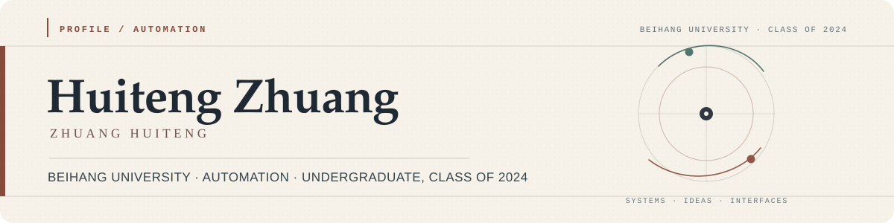

  

Hi, I'm **Huiteng Zhuang**. I enjoy turning complex ideas into systems that actually run.
This page collects my public projects and updates automatically when I publish something new.

## Projects

<!-- PROJECTS:START -->
34 public projects · Ordered by creation date · Refreshes every 6 hours

<table align="center" width="100%">
<tr><td width="50%" valign="top"><a href="https://github.com/ZhuangHT-1201/staywise-hotel-finder"><strong>staywise-hotel-finder</strong></a> Bilingual hotel price comparison with exact-place and… · JavaScript</td><td width="50%" valign="top"><a href="https://github.com/ZhuangHT-1201/meet-in-between"><strong>meet-in-between</strong></a> Find a fair meeting point between two locations. Bili… · TypeScript</td></tr>
<tr><td width="50%" valign="top"><a href="https://github.com/ZhuangHT-1201/local-image-studio"><strong>local-image-studio</strong></a> Local-first one-click ComfyUI studio with unfiltered… · HTML</td><td width="50%" valign="top"><a href="https://github.com/ZhuangHT-1201/forge-agent"><strong>forge-agent</strong></a> Local-first desktop coding agent powered by your own… · Python</td></tr>
<tr><td width="50%" valign="top"><a href="https://github.com/ZhuangHT-1201/rank-peak-lab"><strong>rank-peak-lab</strong></a> Ranked and Peak match analysis for Honor of Kings · JavaScript</td><td width="50%" valign="top"><a href="https://github.com/ZhuangHT-1201/longform-novel-production"><strong>longform-novel-production</strong></a> A portable skill for planning, drafting, auditing, an… · Python</td></tr>
<tr><td width="50%" valign="top"><a href="https://github.com/ZhuangHT-1201/milk-frog-make-me-laugh"><strong>milk-frog-make-me-laugh</strong></a> A chaotic 40-second Milk Frog prank game with eight c… · HTML</td><td width="50%" valign="top"><a href="https://github.com/ZhuangHT-1201/linetrail"><strong>linetrail</strong></a> Turn any image into clean, hand-drawn line art in you… · JavaScript</td></tr>
<tr><td width="50%" valign="top"><a href="https://github.com/ZhuangHT-1201/cloudveil-longevity"><strong>cloudveil-longevity</strong></a> Cloudveil: Path of Longevity — an open-source browser… · JavaScript</td><td width="50%" valign="top"><a href="https://github.com/ZhuangHT-1201/last-ember"><strong>last-ember</strong></a> First-person survival shooter · JavaScript</td></tr>
<tr><td width="50%" valign="top"><a href="https://github.com/ZhuangHT-1201/nova-rift"><strong>nova-rift</strong></a> Browser-based 5v5 MOBA · JavaScript</td><td width="50%" valign="top"><a href="https://github.com/ZhuangHT-1201/hanmo-shanhe-lord"><strong>hanmo-shanhe-lord</strong></a> Han-dynasty city-management strategy · JavaScript</td></tr>
<tr><td width="50%" valign="top"><a href="https://github.com/ZhuangHT-1201/poemscape"><strong>poemscape</strong></a> Four-season interactive poetry game · HTML</td><td width="50%" valign="top"><a href="https://github.com/ZhuangHT-1201/cet6-summit"><strong>cet6-summit</strong></a> CET-6 study planning app · JavaScript</td></tr>
<tr><td width="50%" valign="top"><a href="https://github.com/ZhuangHT-1201/silk-road-seasons"><strong>silk-road-seasons</strong></a> Dunhuang historical strategy game · JavaScript</td><td width="50%" valign="top"><a href="https://github.com/ZhuangHT-1201/banners-of-the-realm"><strong>banners-of-the-realm</strong></a> Song-era real-time strategy game · JavaScript</td></tr>
<tr><td width="50%" valign="top"><a href="https://github.com/ZhuangHT-1201/StarryPocket"><strong>StarryPocket</strong></a> Desktop companion app · Python</td><td width="50%" valign="top"><a href="https://github.com/ZhuangHT-1201/starlit-haven"><strong>starlit-haven</strong></a> Island farming and management game · JavaScript</td></tr>
<tr><td width="50%" valign="top"><a href="https://github.com/ZhuangHT-1201/aether-front"><strong>aether-front</strong></a> Browser real-time strategy game · JavaScript</td><td width="50%" valign="top"><a href="https://github.com/ZhuangHT-1201/nimbus-nook"><strong>nimbus-nook</strong></a> Cozy cloud-fox life game · CSS</td></tr>
<tr><td width="50%" valign="top"><a href="https://github.com/ZhuangHT-1201/lumen-drift"><strong>lumen-drift</strong></a> Light-collecting casual game · JavaScript</td><td width="50%" valign="top"><a href="https://github.com/ZhuangHT-1201/AutoSign"><strong>AutoSign</strong></a> Campus timetable and check-in client · TypeScript</td></tr>
<tr><td width="50%" valign="top"><a href="https://github.com/ZhuangHT-1201/agv-multi-robot-scheduler"><strong>agv-multi-robot-scheduler</strong></a> Multi-robot scheduling and path planning · Python</td><td width="50%" valign="top"><a href="https://github.com/ZhuangHT-1201/three-blade-folding-hub"><strong>three-blade-folding-hub</strong></a> Three-blade folding rotor hub design · Python</td></tr>
<tr><td width="50%" valign="top"><a href="https://github.com/ZhuangHT-1201/pindou-studio"><strong>pindou-studio</strong></a> Image-to-perler-bead pattern tool · TypeScript</td><td width="50%" valign="top"><a href="https://github.com/ZhuangHT-1201/EchoScribe"><strong>EchoScribe</strong></a> Local speech-to-text desktop app · JavaScript</td></tr>
<tr><td width="50%" valign="top"><a href="https://github.com/ZhuangHT-1201/formatforge"><strong>formatforge</strong></a> Local file-format converter · Python</td><td width="50%" valign="top"><a href="https://github.com/ZhuangHT-1201/keep-run-screenshot-generate"><strong>keep-run-screenshot-generate</strong></a> Run-summary image generator · Python</td></tr>
<tr><td width="50%" valign="top"><a href="https://github.com/ZhuangHT-1201/devs_gen_code"><strong>devs_gen_code</strong></a> DEVS agent code generation · Python · Fork</td><td width="50%" valign="top"><a href="https://github.com/ZhuangHT-1201/autodrive_sim"><strong>autodrive_sim</strong></a> Closed-loop autonomous driving simulation · Python</td></tr>
<tr><td width="50%" valign="top"><a href="https://github.com/ZhuangHT-1201/OptPilot"><strong>OptPilot</strong></a> AI optimization workflow orchestration · Fork</td><td width="50%" valign="top"><a href="https://github.com/ZhuangHT-1201/undergraduate-simulation"><strong>undergraduate-simulation</strong></a> Four-year university life simulation game · JavaScript</td></tr>
<tr><td width="50%" valign="top"><a href="https://github.com/ZhuangHT-1201/MyOwnAI"><strong>MyOwnAI</strong></a> Local-first AI desktop assistant · Python</td><td width="50%" valign="top"><a href="https://github.com/ZhuangHT-1201/ThisIsMyDepartment.AI"><strong>ThisIsMyDepartment.AI</strong></a> Virtual department collaboration platform · TypeScript</td></tr>
</table>
<!-- PROJECTS:END -->

  PROJECT INDEX · AUTOMATICALLY UPDATED BY GITHUB ACTIONS

